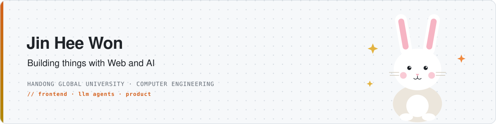

<picture>
  <source media="(prefers-color-scheme: dark)" srcset="assets/banner-dark-v2.svg">
  
</picture>

I build services that solve real user problems with data and technology.  
Interested in AI-powered service development and systems designed around real-world workflows.

 

## 🏆 Awards & Honors

| | 일자 | 수상 / 선정 | 주관 | 관련 프로젝트 |
|:---:|:---:|:---|:---|:---|
| 🥇 | 2026.06 | **2026-1학기 캡스톤 페스티벌 최우수상** | 한동대학교 | [Get(it)Done](#-getitdone) |
| 🥇 | 2026.05 | **SW중심대학 에세이 공모전 최우수상** | 한동대학교 | — |
| 🥇 | 2025.08 | **멋쟁이사자처럼 13기 중앙해커톤 최우수상** | 멋쟁이사자처럼대학 | [어울림](#-어울림) |
| 🥈 | 2025.11 | **2025 SW창업경진대회 우수상** | 한동대학교 | [Get(it)Done](#-getitdone) |
| 🥉 | 2025.11 | **한동 SW페스티벌 장려상** | 한동대학교 | [Bookgie](#-bookgie) |
| 🎯 | 2026.04 | **2026 Tex-Corps 지원사업 선정** | 이화여자대학교 | [Get(it)Done](#-getitdone) |
| 🎯 | 2026.04 | **이노테크 지원사업 선정** | POSTECH | [Get(it)Done](#-getitdone) |

 

## ✨ Featured Projects

### 🚀 Get(it)Done
**멀티모델 AI 챗봇 · 생산성 플랫폼** &nbsp; `2025.07 ~ 2026.06` &nbsp; 벤쳐러스 캡스톤(AI Campus)

> 🥇 캡스톤 페스티벌 최우수상 &nbsp;·&nbsp; 🥈 SW창업경진대회 우수상 &nbsp;·&nbsp; 🎯 Tex-Corps / 이노테크 지원사업 선정

Claude·GPT·Gemini 등 여러 AI 모델을 하나의 인터페이스에서 전환해 쓰는 멀티모델 AI 플랫폼입니다.
대화를 넘어 코드·문서·스프레드시트·이미지까지 생성·편집할 수 있는 생산성 서비스로 설계했습니다.

- **AI Agent 아키텍처 설계** — LangChain·LangGraph 기반 에이전트 구조, RAG 파이프라인, 외부 도구 호출·웹/코드 검색 통합
- **AI 응답 품질 평가 프레임워크 구축** — 모델별 응답을 정확도·일관성·맥락 유지 기준으로 비교 평가, 품질 기준 수립
- **인증·DB 설계** — Firebase·Supabase 기반 인증 및 벡터 검색 데이터 흐름 설계

`Next.js` `FastAPI` `LangChain` `LangGraph` `RAG` `Supabase`

[AI Agent Repository →](https://github.com/JinHeeWond/agent)

---

### 🐟 어울림
**수산물 온라인 경매 플랫폼** &nbsp; `2025.08` &nbsp; 멋쟁이사자처럼 13기 중앙해커톤

> 🥇 멋쟁이사자처럼 대학 중앙해커톤 최우수상

수산물 거래 과정을 효율적으로 연결하기 위한 온라인 경매 서비스입니다.
실시간 경매 화면 UI와 입찰 인터페이스를 구현하며, 복잡한 인터랙션에서도 가독성과 편의성을 유지하는 화면 설계에 집중했습니다.

`React` `JavaScript` `Frontend`

[Repository →](https://github.com/LikeLionHGU/TaxiDriver_Front)

---

### 📚 Bookgie
**독서 몰입력 향상 서비스** &nbsp; 멋쟁이사자처럼 홀리데이 해커톤

> 🥉 한동 SW페스티벌 장려상

독서 몰입력 저하 문제를 해결하기 위한 서비스의 프론트엔드를 담당했습니다.
독서 진행률 시각화와 몰입도 향상 기능을 설계하며 실제 사용자 흐름을 고려한 UI/UX를 구현했습니다.

`React` `JavaScript` `Frontend`

[Repository →](https://github.com/LikeLionHGU/GIGGAL_Front)

---

### 🛌 SleepLab
**AI 기반 수면 자세 분석 대시보드**

Azure Kinect로 수집한 수면 자세 데이터를 사용자별로 조회하고 시각화하는 웹 대시보드입니다.

`Next.js` `TypeScript` `Supabase` `Azure Kinect`

[Repository →](https://github.com/JinHeeWond/sleep-dashboard)

---

### ✅ Task API
**Task Management REST API**

할 일 등록·조회·수정·삭제와 입력 검증, 완료 여부 필터를 구현하고 Docker와 Render로 배포했습니다.

`Java` `Spring Boot` `Docker` `Render`

[Repository →](https://github.com/JinHeeWond/task-api)

 

## 🧭 Activities

| 기간 | 활동 | 역할 |
|:---|:---|:---|
| 2026.07 ~ 2026.12 | **IWL 파트너스 · JOG Foot Care Project** | Physical AI Researcher & 3D Modeling Engineer — 보행 데이터와 3D 발 모델링 데이터 연계 연구 |
| 2026.03 ~ 2026.12 | **한동대학교 AI컴퓨터전자공학부 임원단** | 학부 행사 기획·운영, 예산 집행, 교수진 소통 |
| 2025.12 ~ 2026.01 | **IT창업실습 TA** (한동대학교) | 수업 운영 지원, 보고서 검토·채점 보조 |
| 2025.09 ~ 2025.11 | **2025 DATA VENTURE 문제해결 Challenge** (서울대 빅데이터 혁신융합대학사업단) | 기업 데이터 기반 개발 프로젝트, AWS AI & Cloud 과정 이수 |
| 2025.07 ~ 2026.06 | **벤쳐러스 학회** | Get(it)Done 캡스톤 — AI Agent 설계, 응답 품질 평가 |
| 2025.07 ~ 2025.08 | **연일형산초등학교 코딩 교육 강사** | 초등 3학년 대상 Entry 블록 코딩 커리큘럼 구성·강의 |
| 2024.12 ~ 2025.09 | **멋쟁이사자처럼 13기 프론트엔드** | 중앙해커톤·홀리데이 해커톤·아이디어톤 참여 |

 

## 🛠 Tech Stack

**Frontend**

**AI · LLM**

**Backend · Data**

**Tools**

 

Thanks for visiting 🙂

